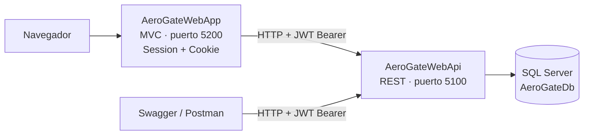
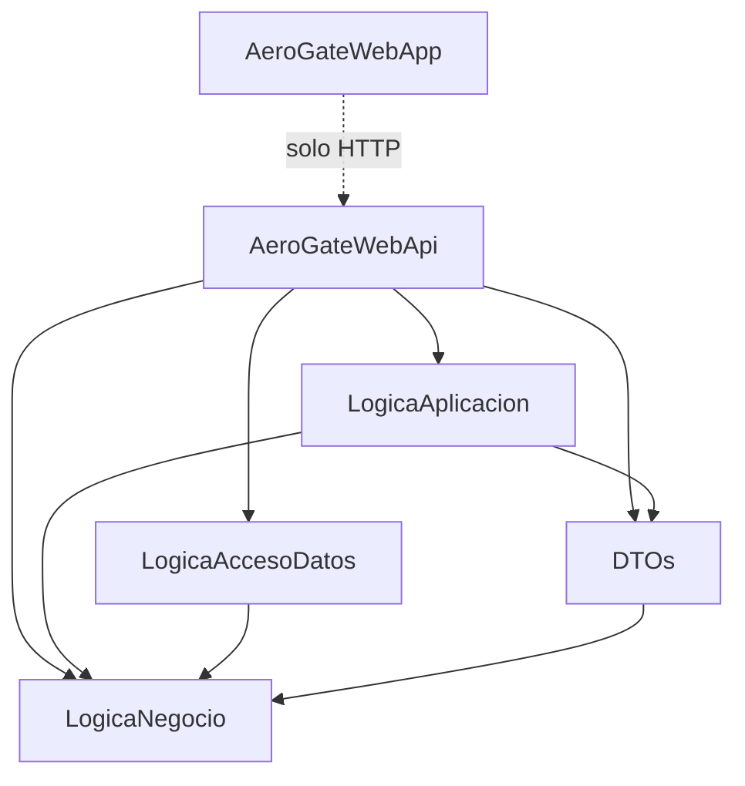
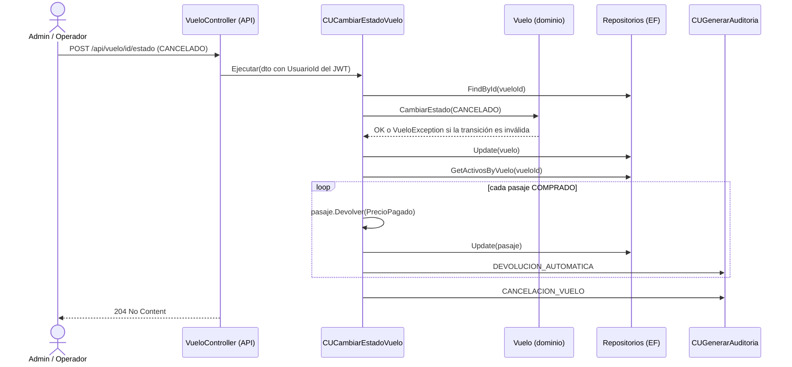
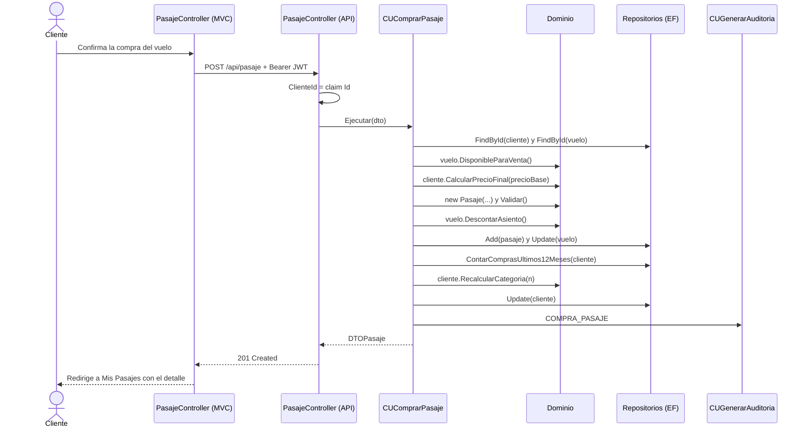

# ✈️ AeroGate — Documento de Contexto y Especificación del Sistema

| | |
|---|---|
| **Versión del documento** | 1.0 |
| **Fecha** | 2026-10-02 |
| **Autor** | Sebastián Parodi |
| **Estado del sistema** | Versión funcional completa (MVP): RF01 a RF12 implementados y verificados |
| **Commit de referencia** | `68d2bba` (rama `main`) |
| **Documentos relacionados** | [LETRA.md](LETRA.md) · [DiagramaClases.md](DiagramaClases.md) · [README](../README.md) |

> Documento vivo. Concentra el contexto completo del proyecto para poder retomarlo en cualquier momento.
> Estructura basada en la Especificación de Requerimientos de Software (IEEE 830 / ISO/IEC/IEEE 29148),
> en el modelo de calidad ISO/IEC 25010 y en el formato de casos de uso extendidos usado en Desarrollo Web.

## Índice

1. [Introducción](#1-introducción)
2. [Descripción general del sistema](#2-descripción-general-del-sistema)
3. [Estado actual](#3-estado-actual)
4. [Arquitectura y diseño](#4-arquitectura-y-diseño)
5. [Requerimientos funcionales y trazabilidad](#5-requerimientos-funcionales-y-trazabilidad)
6. [Reglas de negocio](#6-reglas-de-negocio)
7. [Flujos de trabajo de los requerimientos principales](#7-flujos-de-trabajo-de-los-requerimientos-principales)
8. [Atributos de calidad (requerimientos no funcionales)](#8-atributos-de-calidad-requerimientos-no-funcionales)
9. [Verificación y pruebas](#9-verificación-y-pruebas)
10. [Deuda técnica y backlog priorizado](#10-deuda-técnica-y-backlog-priorizado)
11. [Ejecución y entorno](#11-ejecución-y-entorno)
12. [El proyecto dentro del portfolio](#12-el-proyecto-dentro-del-portfolio)
13. [Historial del documento](#13-historial-del-documento)

---

## 1. Introducción

### 1.1 Propósito

Describir qué es AeroGate, cómo está construido, qué reglas de negocio implementa, cómo recorre cada requerimiento las capas del sistema, en qué estado se encuentra y qué falta para llevarlo a calidad de producción.

### 1.2 Alcance

AeroGate digitaliza la operación de la aerolínea ficticia **AeroSur** (Aeropuerto de Carrasco): registro de clientes con categorías de fidelidad, venta y devolución de pasajes, ciclo de vida de los vuelos, catálogo de aeropuertos y auditoría de las operaciones críticas.

**Dentro del alcance (v1):** catálogo de aeropuertos · CRUD y estados de vuelos · compra y devolución de pasajes · categorías de fidelidad · usuarios internos · auditoría · consultas (mis pasajes, pasajeros por vuelo, ranking de destinos).

**Fuera del alcance (v1):** cobro real (el precio se registra pero no se procesa un pago) · selección de asiento numerado · escalas y conexiones · varios pasajeros por compra · equipaje · notificaciones por email · recuperación de contraseña.

### 1.3 Glosario

| Término | Definición |
|---|---|
| **Vuelo** | Trayecto programado entre dos aeropuertos, con código único (ej. `AS101`), fecha, precio base, capacidad y estado. |
| **Pasaje** | Compra de un asiento de un vuelo por parte de un cliente. Estados: `COMPRADO` / `DEVUELTO`. |
| **Categoría de cliente** | Nivel de fidelidad (`ESTANDAR`, `FRECUENTE`, `PREMIUM`) que define descuento y porcentaje de reintegro. |
| **Código IATA** | Identificador internacional de 3 letras de un aeropuerto (ej. `MVD`, `EZE`). |
| **Máquina de estados** | Conjunto de transiciones válidas entre los estados de un vuelo. |
| **Foto histórica** | Dato que se congela al momento de la operación (precio pagado, descuento) y no se recalcula después. |
| **Baja lógica** | Marcar un registro como eliminado (`Eliminado = true`) sin borrarlo físicamente. |
| **Auditoría** | Registro inmutable de quién realizó qué operación, cuándo y sobre qué entidad. |
| **TPH** | *Table Per Hierarchy*: estrategia de EF Core que guarda toda una jerarquía de herencia en una sola tabla con columna discriminadora. |
| **Value Object (VO)** | Objeto sin identidad propia, definido por su valor y con validación propia (ej. `PasswordVO`). |
| **DTO** | *Data Transfer Object*: objeto plano que viaja por HTTP; las entidades del dominio nunca salen de la API. |
| **Caso de uso (CU)** | Clase de la capa de aplicación que orquesta una operación de negocio (un CU = una clase + su interfaz `ICU`). |
| **JWT / Claim** | Token firmado que identifica al usuario; los *claims* son los datos que lleva adentro (Id, Email, Rol). |
| **Standalone** | Aplicación que se ejecuta en su propio proceso y se comunica con la otra solo por HTTP. |
| **Seed** | Datos iniciales que la API inserta al arrancar si la base está vacía. |

### 1.4 Referencias

- [LETRA.md](LETRA.md) — enunciado del proyecto (escenario, roles, dominio, RF, requerimientos técnicos).
- [DiagramaClases.md](DiagramaClases.md) — modelo de dominio, enumerados, máquina de estados, VOs e interfaces de repositorio.
- [README.md](../README.md) — presentación del repositorio, ejecución y endpoints.
- Obligatorio **StellarMinds** (Desarrollo Web 2026) — proyecto base cuya arquitectura y convenciones se reutilizan y mejoran.

---

## 2. Descripción general del sistema

### 2.1 Perspectiva del producto

Dos aplicaciones independientes. Toda la lógica de negocio vive en la API; el cliente MVC no referencia ningún proyecto de negocio ni de acceso a datos.



> Nota: el MVC llama a la API **desde el servidor** (HttpClient), por lo que CORS no interviene en ese tramo. La política CORS configurada en la API recién sería necesaria si se agrega un frontend que llame a la API directamente desde el navegador (por ejemplo, React).

### 2.2 Actores y permisos

| Funcionalidad | Visitante | Cliente | Operador | Administrador |
|---|:-:|:-:|:-:|:-:|
| Registrarse como cliente | ✅ | | | |
| Iniciar sesión | ✅ | ✅ | ✅ | ✅ |
| Comprar / devolver pasajes, ver "Mis pasajes" | | ✅ | | |
| Ver ranking de destinos | | ✅ | ✅ | ✅ |
| Listar vuelos y cambiar su estado | | | ✅ | ✅ |
| Alta, modificación y baja de vuelos | | | | ✅ |
| Gestionar aeropuertos (alta, modificación, búsqueda) | | | ✅ | ✅ |
| Ver pasajeros de un vuelo | | | ✅ | ✅ |
| Ver auditoría | | | Solo las propias | Todas |
| Alta y listado de usuarios internos | | | | ✅ |

### 2.3 Restricciones

- Plataforma: .NET 10, ASP.NET Core 10, Entity Framework Core 10, SQL Server.
- El cliente MVC es un consumidor HTTP puro: no referencia `LogicaNegocio`, `LogicaAplicacion` ni EF.
- Toda regla de negocio se valida en la API (dominio y casos de uso); el MVC solo mejora la experiencia de uso.
- La autorización real la hace la API con el JWT; los filtros del MVC solo redirigen antes de mostrar pantallas no permitidas.

### 2.4 Supuestos

- Precios en dólares, sin conversión de moneda.
- Un pasaje equivale a un asiento sin número asignado.
- Las fechas se manejan en hora local del servidor (`DateTime.Now`), sin zona horaria.

---

## 3. Estado actual

### 3.1 Métricas del código

| Elemento | Cantidad |
|---|---|
| Proyectos | 6 (5 en `AeroGate.sln` + `AeroGateWebApp` standalone) |
| Archivos versionados / líneas | 170 / ≈ 7.700 |
| Entidades · Enumerados · Value Objects | 9 · 5 · 3 |
| Interfaces de repositorio / implementaciones EF | 5 / 5 |
| Casos de uso (con su interfaz) | 23 |
| Endpoints de la API | 23 (incluye login) |
| Controllers MVC · Vistas Razor | 7 · 21 |
| Migraciones | 1 (`MigracionInicial`) |

### 3.2 Verificación realizada

- **Compilación:** 0 errores, 0 advertencias en los 6 proyectos.
- **Prueba de humo de la API (2026-07-04):** 12/12 casos correctos (detalle en la [sección 9](#9-verificación-y-pruebas)).
- **Prueba de punta a punta del MVC:** login por formulario → sesión → dashboard con datos reales traídos de la API.

### 3.3 Avisos vigentes

> ⚠️ **Base de desarrollo sin vuelos vendibles.** El seed generó los vuelos con fechas relativas al 2026-07-04 y no vuelve a ejecutarse si la base ya tiene datos. Desde fines de julio todos los vuelos sembrados quedaron en el pasado y el listado de vuelos disponibles aparece vacío. Solución inmediata: borrar la base y dejar que la API la regenere al arrancar (ver [sección 11](#11-ejecución-y-entorno)). Solución definitiva: ítem **BL-05** del backlog.

> ⚠️ **Repositorio sin remoto.** El repo local tiene un único commit y todavía no se subió a GitHub (ítem **BL-06**).

---

## 4. Arquitectura y diseño

### 4.1 Capas y dependencias



**Regla de dependencia:** todas las flechas apuntan hacia el dominio. `LogicaAplicacion` conoce únicamente las interfaces `IRepositorio*` y no referencia EF; la implementación concreta se conecta por inyección de dependencias en `Program.cs`. (Mejora respecto de StellarMinds, donde la capa de aplicación referenciaba la de acceso a datos.)

### 4.2 Responsabilidad de cada proyecto

| Proyecto | Responsabilidad | Contenido principal |
|---|---|---|
| `LogicaNegocio` | Dominio: reglas y validaciones | `Entidades/`, `Enumerados/`, `ValueObjects/`, `IRepositorios/`, `Excepciones/`, `InterfacesDominio/IValidable`, `InterfacesServicio/`, `Consultas/RankingDestino` |
| `LogicaAplicacion` | Orquestación de casos de uso | `CasosDeUso/CU{Usuario,Aeropuerto,Vuelo,Pasaje,Auditoria}/` + `ICasosDeUso/` espejo |
| `LogicaAccesoDatos` | Persistencia | `AeroGateContext` (Fluent API), `EF/Repositorios/`, `Migrations/` |
| `DTOs` | Contratos HTTP | `DataTransferObjects/DTOs{Entidad}/`, `Mappers/` estáticos |
| `AeroGateWebApi` | API REST | `Controllers/`, `CarpetaJWT/AuthorizationJWT.cs`, `Program.cs` (DI, JWT, Swagger, seed) |
| `AeroGateWebApp` | Cliente web | `Auxiliar/`, `Filter/`, `Enums/`, `Models/ViewModels.cs`, `Controllers/`, `Views/` |

### 4.3 Decisiones de diseño (registro tipo ADR)

| # | Decisión | Alternativa descartada | Motivo |
|---|---|---|---|
| ADR-01 | Dos aplicaciones standalone (API + MVC) | MVC con acceso directo a la base | Separación de responsabilidades; la API es reutilizable por otros clientes (Postman, React, móvil). |
| ADR-02 | Herencia TPH: `Usuario → Cliente \| Empleado → Administrador \| Operador` | TPT / TPC | Una sola tabla, consultas simples (`OfType<Cliente>()`), el rol se deriva del tipo concreto. |
| ADR-03 | Categoría como enumerado con reglas en `Cliente` | Entidad `CategoriaCliente` con tabla | Simplicidad. Costo asumido: los porcentajes viven en el código. |
| ADR-04 | Máquina de estados dentro de la entidad `Vuelo` | Validar transiciones en el CU o el controller | Dominio rico: una sola fuente de verdad para las transiciones. |
| ADR-05 | La devolución vive dentro de `Pasaje` | Entidad `Devolucion` aparte | Relación 1 a 1; la trazabilidad (quién y cuándo) queda en `Auditoria`. |
| ADR-06 | FKs explícitas junto a las navegaciones | *Shadow properties* | Control total desde el código; desambigua las dos relaciones `Vuelo → Aeropuerto`; permite dar de alta sin cargar entidades. |
| ADR-07 | Aeropuertos sin baja | Baja lógica | Catálogo estable referenciado por vuelos históricos. |
| ADR-08 | El actor de cada operación sale del claim `Id` del JWT | Id en el body o en la query | Impide actuar en nombre de otro usuario (OWASP A01). |
| ADR-09 | Auditoría por composición de casos de uso (`CUGenerarAuditoria`) | Triggers o interceptores de EF | Explícita, testeable y con contexto de negocio (detalle legible). |
| ADR-10 | Enumerados guardados como texto en la base | Enteros | Legibilidad al consultar en SSMS. |
| ADR-11 | Precio pagado y descuento congelados en el pasaje | Recalcular con la categoría actual | Integridad contable de las compras pasadas. |
| ADR-12 | Seed con fechas relativas a la fecha de arranque | Fechas fijas | Demo vendible en una base nueva (ver aviso 3.3 sobre bases existentes). |

### 4.4 Patrones de diseño aplicados

| Patrón / principio | Dónde se aplica |
|---|---|
| **Repository** | `IRepositorio*` (dominio) e implementaciones en `LogicaAccesoDatos/EF/Repositorios/` |
| **Inversión de dependencias + DI** | Los CUs dependen de interfaces; `Program.cs` registra 5 repositorios y 23 CUs con `AddScoped` |
| **Responsabilidad única** | Un caso de uso por clase, cada uno con su interfaz |
| **DTO + Mapper** | Proyecto `DTOs`: las entidades nunca viajan por HTTP |
| **Value Object** | `NombreCompletoVO`, `PasswordVO` (operador implícito, igualdad por valor), `CodigoIATAVO` |
| **Fábrica simple** | `CUAltaEmpleado.CrearSegunRol()` crea `Administrador` u `Operador` según el rol |
| **Fachada** | `ClienteHttpAuxiliar` centraliza todas las llamadas HTTP del MVC |
| **Herencia de filtros** | `RolFilterBase` + `LoginFilter`, `SoloAdminFilter`, `AdminYOperadorFilter`, `SoloClienteFilter` |
| **Composición de casos de uso** | Los CUs de escritura reciben `ICUGenerarAuditoria` por constructor |
| *Candidatos* | **State** para la máquina de estados (hoy un `switch`) · **Strategy** para el hasheo de contraseñas (ver BL-01 y BL-20) |

### 4.5 Modelo de datos físico

| Tabla | Columnas relevantes | Restricciones |
|---|---|---|
| `Usuarios` | `Id`, `TipoUsuario` (discriminador), `NombreCompleto_Nombre`, `NombreCompleto_Apellido`, `Email`, `Pass`, `FechaIngreso`*, `Documento`*, `Direccion`*, `Categoria`* | Índice único en `Email` |
| `Aeropuertos` | `Id`, `CodigoIATA`, `Nombre`, `Ciudad`, `Pais` | Unicidad de IATA controlada por el CU |
| `Vuelos` | `Id`, `Codigo`, `AeropuertoOrigenId`, `AeropuertoDestinoId`, `FechaSalida`, `FechaLlegadaEstimada`, `PrecioBase` (10,2), `CapacidadAsientos`, `AsientosDisponibles`, `Estado`, `Eliminado` | Índice único en `Codigo`; 2 FK a `Aeropuertos` |
| `Pasajes` | `Id`, `ClienteId`, `VueloId`, `FechaCompra`, `PrecioPagado` (10,2), `DescuentoAplicado` (5,4), `Estado`, `FechaDevolucion`, `MontoReintegrado` | FK a `Usuarios` y `Vuelos` |
| `Auditorias` | `Id`, `UsuarioId`, `Operacion`, `Detalle`, `FechaHora`, `VueloId`, `PasajeId`, `AeropuertoId` | FK a `Usuarios` |

\* Columnas que admiten nulos porque pertenecen a un solo subtipo de la jerarquía TPH (desnormalización controlada a cambio de no hacer joins entre tablas de subtipos). Todas las FK usan `ON DELETE RESTRICT`.

---

## 5. Requerimientos funcionales y trazabilidad

| RF | Descripción | Rol | Casos de uso | Endpoint(s) | Vista MVC | Estado |
|---|---|---|---|---|---|---|
| RF01 | Registro de cliente | Público | `CURegistrarCliente` | `POST /api/usuario/registro` | `Login/Registro` | ✅ |
| RF02 | Alta y listado de usuarios internos | Admin | `CUAltaEmpleado`, `CUListarUsuarios` | `POST /api/usuario/empleados`, `GET /api/usuario` | `Usuario/Create`, `Usuario/Index` | ✅ |
| RF03 | Login | Todos | `CULogin` | `POST /api/auth/login` | `Login/Index` | ✅ |
| RF04 | CRUD de vuelos con baja lógica | Admin (lectura también Operador) | `CUAltaVuelo`, `CUModificarVuelo`, `CUEliminarVuelo`, `CUListarVuelos`, `CUGetVueloPorId` | `GET/POST /api/vuelo`, `GET/PUT/DELETE /api/vuelo/{id}` | `Vuelo/Index`, `Create`, `Edit` | ✅ |
| RF05 | Cambio de estado de vuelo | Admin / Operador | `CUCambiarEstadoVuelo` | `POST /api/vuelo/{id}/estado` | `Vuelo/Index` (selector) | ✅ |
| RF06 | Compra de pasaje | Cliente | `CUListarVuelosDisponibles`, `CUComprarPasaje` | `GET /api/vuelo/disponibles`, `POST /api/pasaje` | `Pasaje/Comprar` | ✅ |
| RF07 | Devolución de pasaje | Cliente | `CUDevolverPasaje` (`CalcularMonto` + `Ejecutar`) | `GET /api/pasaje/{id}/monto-devolucion`, `POST /api/pasaje/{id}/devolucion` | `Pasaje/ConfirmarDevolucion` | ✅ |
| RF08 | Mis pasajes por mes/año | Cliente | `CUMisPasajes` | `GET /api/pasaje/mis-pasajes?mes=&anio=` | `Pasaje/MisPasajes` | ✅ |
| RF09 | Pasajeros de un vuelo | Admin / Operador | `CUListarPasajerosPorVuelo` | `GET /api/pasaje/pasajeros-por-vuelo/{id}` | `Pasaje/PasajerosPorVuelo` | ✅ |
| RF10 | Ranking de destinos | Todos | `CURankingDestinos` | `GET /api/pasaje/ranking-destinos` | `Pasaje/Ranking` | ✅ |
| RF11 | Auditoría con filtros | Admin / Operador | `CUListarAuditorias` (+ `CUGenerarAuditoria` interno) | `GET /api/auditoria` | `Auditoria/Index` | ✅ (filtros en el MVC) |
| RF12 | Gestión de aeropuertos | Admin / Operador | `CUAltaAeropuerto`, `CUModificarAeropuerto`, `CUListarAeropuertos`, `CUGetAeropuertoPorId` | `GET/POST /api/aeropuerto`, `GET/PUT /api/aeropuerto/{id}` | `Aeropuerto/Index`, `Create`, `Edit` | ✅ |
| RF13 | Evaluación de condiciones con IA + respaldo por reglas | Admin / Operador | — (contrato `IEvaluacionClimaService` ya definido) | — | — | ⏳ Pendiente |

Otros endpoints de soporte: `GET /api/usuario/clientes` (Admin/Operador).

---

## 6. Reglas de negocio

| Código | Regla | Dónde se implementa |
|---|---|---|
| RN-01 | Todo cliente se registra en categoría `ESTANDAR`. | Constructor de `Cliente` |
| RN-02 | La categoría depende de las compras de los últimos 12 meses: 0–4 `ESTANDAR`, 5–9 `FRECUENTE`, 10 o más `PREMIUM`. Se recalcula después de cada compra; las devoluciones no restan compras. | `Cliente.RecalcularCategoria()` + `RepositorioPasaje.ContarComprasUltimos12Meses()` |
| RN-03 | Descuento al comprar: 0 % / 10 % / 15 % según categoría. | `Cliente.ObtenerDescuento()`, `CalcularPrecioFinal()` |
| RN-04 | Reintegro al devolver: 70 % / 90 % / 100 % según la categoría **al momento de la devolución**. | `Cliente.ObtenerPorcentajeReintegro()`, `CalcularReintegro()` |
| RN-05 | Precio pagado y descuento aplicado quedan congelados en el pasaje. | Constructor de `Pasaje` |
| RN-06 | Solo se vende un vuelo `PROGRAMADO` o `DEMORADO`, con asientos y no eliminado. El listado para el cliente además exige salida futura. | `Vuelo.DisponibleParaVenta()`, `RepositorioVuelo.GetDisponiblesParaVenta()` |
| RN-07 | Cada compra descuenta un asiento; cada devolución voluntaria lo repone. | `Vuelo.DescontarAsiento()`, `ReponerAsiento()` |
| RN-08 | Devolución voluntaria: solo pasajes propios, en estado `COMPRADO` y con el vuelo `PROGRAMADO` o `DEMORADO`. | `Pasaje.EsDevolvible()`, `CUDevolverPasaje` |
| RN-09 | Transiciones válidas: `PROGRAMADO → DEMORADO / EMBARQUE / CANCELADO`; `DEMORADO → PROGRAMADO / EMBARQUE / CANCELADO`; `EMBARQUE → EN_VUELO / CANCELADO`; `EN_VUELO → ATERRIZADO`. `ATERRIZADO` y `CANCELADO` son finales. | `Vuelo.EsTransicionValida()`, `CambiarEstado()` |
| RN-10 | Cancelar un vuelo devuelve el 100 % de todos sus pasajes `COMPRADO`, sin importar la categoría. | `CUCambiarEstadoVuelo` |
| RN-11 | Un vuelo solo se modifica en estado `PROGRAMADO`; la capacidad no puede quedar por debajo de los asientos vendidos; el código es inmutable. | `Vuelo.PuedeModificarse()`, `CUModificarVuelo` |
| RN-12 | Un vuelo con pasajes `COMPRADO` no se elimina (solo se cancela). La eliminación es lógica. | `CUEliminarVuelo` |
| RN-13 | Vuelo válido: código `^[A-Z]{2}\d{1,4}$` y único; origen y destino existentes y distintos; salida futura; llegada posterior a la salida; precio y capacidad mayores a cero. | `Vuelo.Validar()`, `CUAltaVuelo` |
| RN-14 | Aeropuerto válido: código IATA `^[A-Z]{3}$`, único e inmutable; nombre, ciudad y país obligatorios. No se elimina. | `CodigoIATAVO.Validar()`, `Aeropuerto.Validar()`, `CUAltaAeropuerto` |
| RN-15 | Usuario válido: email con formato correcto y único; contraseña de 8 o más caracteres con mayúscula, número y carácter especial. Cliente: documento de 7 u 8 dígitos y dirección. Empleado: fecha de ingreso no futura. | `PasswordVO`, `Usuario`, `Cliente`, `Empleado` (`Validar()`) |
| RN-16 | La auditoría es inmutable (solo alta). El Administrador ve todas las operaciones; el Operador, solo las suyas. | `IRepositorioAuditoria` sin `Update`/`Remove`; `AuditoriaController` |
| RN-17 | La identidad de quien opera se toma siempre del JWT, nunca del request. | Controllers de la API (`User.FindFirst("Id")`) |

---

## 7. Flujos de trabajo de los requerimientos principales

Cada flujo recorre las capas: **Vista MVC → Controller MVC → Controller API → Caso de uso → Dominio → Repositorio → Base de datos**. Formato de caso de uso extendido, igual al usado en Desarrollo Web.

### CU-01 — Iniciar sesión (RF03)

| Campo | Detalle |
|---|---|
| **Actor principal** | Cualquier usuario registrado |
| **Tipo** | Autenticación |
| **Disparador** | El usuario ingresa a la aplicación (la ruta por defecto es `/Login`). |

**Precondiciones:** el usuario existe en el sistema y la API está en ejecución.

**Flujo principal**

| # | Actor | Sistema |
|---|---|---|
| 1 | Ingresa email y contraseña y envía el formulario. | |
| 2 | | `LoginController` (MVC) envía `POST /api/auth/login` con `{ Email, Pass }`. |
| 3 | | `CULogin` busca el usuario por email (`FindByEmail`). |
| 4 | | Compara la contraseña con `PasswordVO`: el texto se convierte por el operador implícito y se compara por valor (`!=`). |
| 5 | | Genera el JWT (HMAC-SHA256, vigencia de 2 horas) con los claims `Id`, `Email`, `Name`, `Surname` y `Role`; el rol se deriva del tipo concreto de la jerarquía (`MapperUsuario.ObtenerRol`). |
| 6 | | Devuelve `LoginResponse` con token, expiración, datos del usuario y rol. |
| 7 | | El MVC guarda `token`, `rol`, `id` y `nombre` en la sesión y redirige a `Home`. |
| 8 | | `Home` arma el panel según el rol con llamadas autenticadas a la API. |

**Flujos alternativos**
- **2a — Campos vacíos:** `UsuarioException` → `401` con el motivo; el formulario muestra el error.
- **3a / 4a — Email inexistente o contraseña incorrecta:** el mismo mensaje "Credenciales inválidas" para ambos casos (no revela cuál de los dos falló) → `401`.
- **8a — Token vencido con la sesión MVC aún activa:** la API responde `401` y las pantallas quedan vacías (sin manejo global; ver BL-15).

**Postcondiciones:** sesión MVC con un token válido; menú y panel adaptados al rol.

**Técnico:** `AuthorizationJWT.MapAuthEndpoints()` (Minimal API, `[AllowAnonymous]`) · records `LoginRequest` / `LoginResponse` · sesión MVC de 30 minutos de inactividad.

---

### CU-02 — Registro de cliente (RF01)

| Campo | Detalle |
|---|---|
| **Actor principal** | Visitante |
| **Tipo** | Alta de entidad (público) |
| **Disparador** | El visitante elige "Registrarse". |

**Precondiciones:** ninguna (endpoint público).

**Flujo principal**

| # | Actor | Sistema |
|---|---|---|
| 1 | Completa nombre, apellido, email, contraseña, documento y dirección y envía. | |
| 2 | | El MVC envía `POST /api/usuario/registro` (sin token). |
| 3 | | `CURegistrarCliente` verifica que el email no esté registrado (`FindByEmail`). |
| 4 | | Crea `NombreCompletoVO` y `Cliente` (categoría inicial `ESTANDAR`). |
| 5 | | `Cliente.Validar()` valida nombre, fortaleza de la contraseña, formato del email, documento y dirección. |
| 6 | | Persiste el cliente → `201 Created`. |
| 7 | | El MVC redirige al login con el mensaje "Registro exitoso". |

**Flujos alternativos**
- **3a — Email ya registrado:** `UsuarioException` → `400`; el formulario conserva los datos y muestra el error.
- **5a — Dato inválido** (contraseña débil, documento con letras, email mal formado): `UsuarioException` con el motivo concreto → `400`.

**Postcondiciones:** nuevo cliente `ESTANDAR` habilitado para iniciar sesión.

**Técnico:** `UsuarioController.Registro` `[AllowAnonymous]` · `DTORegistrarCliente` · dependencia `IRepositorioUsuario` · no se audita (la letra no lo exige).

---

### CU-03 — Gestión de vuelos: alta, modificación y baja (RF04)

| Campo | Detalle |
|---|---|
| **Actor principal** | Administrador |
| **Tipo** | ABM con reglas por estado |
| **Disparador** | El administrador elige "+ Nuevo Vuelo", "Editar" o "Eliminar" en `Vuelo/Index`. |

**Precondiciones:** sesión con rol `ADMINISTRADOR`; existen al menos dos aeropuertos.

**Flujo principal (alta)**

| # | Actor | Sistema |
|---|---|---|
| 1 | Elige "+ Nuevo Vuelo". | |
| 2 | | Muestra el formulario con los aeropuertos cargados desde `GET /api/aeropuerto`. |
| 3 | Ingresa código, origen, destino, fechas, precio y capacidad y envía. | |
| 4 | | El MVC envía `POST /api/vuelo`; la API completa `UsuarioId` desde el JWT. |
| 5 | | `CUAltaVuelo` crea el `Vuelo` (estado `PROGRAMADO`, asientos disponibles = capacidad) y ejecuta `Validar()` (RN-13). |
| 6 | | Verifica que el código no exista (`FindByCodigo`) y que ambos aeropuertos existan. |
| 7 | | Persiste el vuelo y registra la auditoría `ALTA_VUELO`. |
| 8 | | Responde `201`; el MVC vuelve al listado con mensaje de éxito. |

**Variante — Modificación:** solo se ofrece en estado `PROGRAMADO`. `CUModificarVuelo` verifica existencia y estado, valida aeropuertos, impide que la capacidad quede por debajo de los asientos vendidos, recalcula los asientos disponibles, valida, persiste y audita `MODIFICACION_VUELO`. El código no se modifica.

**Variante — Baja lógica:** `CUEliminarVuelo` busca pasajes `COMPRADO` del vuelo; si no hay, marca `Eliminado = true` y audita `BAJA_VUELO`. El vuelo deja de aparecer en todos los listados.

**Flujos alternativos**
- **5a — Datos inválidos** (código mal formado, origen igual a destino, salida en el pasado, llegada antes de la salida): `VueloException` → `400`.
- **6a — Código duplicado o aeropuerto inexistente:** `VueloException` → `400`.
- **Modificación 1a — Vuelo que ya no está `PROGRAMADO`:** `VueloException` → `400`.
- **Baja 1a — Vuelo con pasajes vendidos:** `VueloException("solo puede cancelarse")` → `400`.
- **Operador intenta el alta:** el filtro del MVC lo redirige; si llama a la API directamente, `403`.

**Postcondiciones:** vuelo creado, modificado o dado de baja, con su registro de auditoría.

**Técnico:** `VueloController` (API) `[Authorize(Roles = "ADMINISTRADOR")]` en POST/PUT/DELETE · `DTOAltaVuelo`, `DTOModificarVuelo` · dependencias `IRepositorioVuelo`, `IRepositorioAeropuerto`, `IRepositorioPasaje`, `ICUGenerarAuditoria`.

---

### CU-04 — Cambio de estado de vuelo y cancelación (RF05)

| Campo | Detalle |
|---|---|
| **Actor principal** | Administrador u Operador |
| **Tipo** | Transición de estado con efecto en cascada |
| **Disparador** | El actor elige un nuevo estado en el selector de la fila del vuelo y confirma. |

**Precondiciones:** sesión con rol `ADMINISTRADOR` u `OPERADOR`; el vuelo existe y no está en un estado final.

**Flujo principal**

| # | Actor | Sistema |
|---|---|---|
| 1 | | `Vuelo/Index` muestra para cada vuelo solo las transiciones válidas desde su estado actual. |
| 2 | Elige el nuevo estado y confirma. | |
| 3 | | El MVC envía `POST /api/vuelo/{id}/estado` con `NuevoEstado`; la API completa `UsuarioId` desde el JWT. |
| 4 | | `CUCambiarEstadoVuelo` busca el vuelo y convierte el texto al enumerado (`Enum.TryParse`). |
| 5 | | `vuelo.CambiarEstado(nuevo)` valida la transición contra la máquina de estados (RN-09). |
| 6 | | Persiste el vuelo y registra la auditoría `CAMBIO_ESTADO`. |
| 7 | | Responde `204`; el MVC muestra "El vuelo pasó a {estado}". |

**Flujo alternativo — Cancelación (paso 6 cuando el nuevo estado es `CANCELADO`)**
- 6.1 Obtiene los pasajes `COMPRADO` del vuelo (`GetActivosByVuelo`).
- 6.2 Por cada pasaje: `pasaje.Devolver(PrecioPagado)` (reintegro del 100 %), lo persiste y registra `DEVOLUCION_AUTOMATICA`.
- 6.3 Registra `CANCELACION_VUELO`. El MVC informa que se devolvió el 100 % de los pasajes vendidos.

**Excepciones**
- **4a — Estado inexistente:** `VueloException("no es un estado de vuelo válido")` → `400`.
- **5a — Transición inválida** (por ejemplo `ATERRIZADO → EMBARQUE`): `VueloException("Transición inválida...")` → `400`.

**Postcondiciones:** vuelo en el nuevo estado; si se canceló, todos sus pasajes quedan `DEVUELTO` con reintegro total y auditados.



**Técnico:** `DTOCambiarEstadoVuelo` · dependencias `IRepositorioVuelo`, `IRepositorioPasaje`, `ICUGenerarAuditoria`. Las operaciones no están envueltas en una transacción (ver BL-04).

---

### CU-05 — Compra de pasaje (RF06)

| Campo | Detalle |
|---|---|
| **Actor principal** | Cliente |
| **Tipo** | Transacción de negocio con efectos múltiples |
| **Disparador** | El cliente elige "Comprar Pasaje" en el menú. |

**Precondiciones:** sesión con rol `CLIENTE`; existe al menos un vuelo disponible para la venta.

**Flujo principal**

| # | Actor | Sistema |
|---|---|---|
| 1 | Elige "Comprar Pasaje". | |
| 2 | | Muestra los vuelos de `GET /api/vuelo/disponibles` (RN-06): ruta, horarios, precio base y asientos libres. |
| 3 | Elige un vuelo y confirma. | |
| 4 | | El MVC envía `POST /api/pasaje` con `{ VueloId }`; la API toma `ClienteId` del claim `Id` del JWT. |
| 5 | | `CUComprarPasaje` obtiene el usuario y verifica que sea un `Cliente`. |
| 6 | | Obtiene el vuelo y verifica `DisponibleParaVenta()`. |
| 7 | | Calcula el precio final con el descuento de la categoría vigente (RN-03) y crea el `Pasaje` congelando precio y descuento (RN-05); lo valida. |
| 8 | | Descuenta un asiento (`DescontarAsiento`), persiste el pasaje y actualiza el vuelo. |
| 9 | | Cuenta las compras de los últimos 12 meses, recalcula la categoría del cliente (RN-02) y la persiste. |
| 10 | | Registra la auditoría `COMPRA_PASAJE` (actor: el propio cliente). |
| 11 | | Responde `201` con el `DTOPasaje`; el MVC redirige a "Mis Pasajes" mostrando el monto y el descuento aplicado. |

**Flujos alternativos**
- **5a — El usuario no es cliente:** `UsuarioException` → `400`. (El filtro `SoloClienteFilter` y el rol del endpoint ya lo impiden antes.)
- **6a — Vuelo inexistente o eliminado:** `VueloException` → `400`.
- **6b — Vuelo no vendible** (estado distinto de `PROGRAMADO`/`DEMORADO` o sin asientos): `PasajeException` → `400`; el MVC vuelve al listado con el error.

**Postcondiciones:** pasaje `COMPRADO`, un asiento menos en el vuelo, categoría del cliente actualizada y operación auditada.



**Técnico:** `[Authorize(Roles = "CLIENTE")]` · `DTOComprarPasaje` · dependencias `IRepositorioPasaje`, `IRepositorioVuelo`, `IRepositorioUsuario`, `ICUGenerarAuditoria`. Riesgo conocido: dos compras simultáneas del último asiento pueden sobrevender (ver BL-03).

---

### CU-06 — Devolución voluntaria de pasaje (RF07)

| Campo | Detalle |
|---|---|
| **Actor principal** | Cliente |
| **Tipo** | Transacción con confirmación previa |
| **Disparador** | El cliente elige "Devolver" sobre un pasaje `COMPRADO` en "Mis Pasajes". |

**Precondiciones:** sesión con rol `CLIENTE`; el pasaje le pertenece y está `COMPRADO`.

**Flujo principal**

| # | Actor | Sistema |
|---|---|---|
| 1 | Elige "Devolver" en un pasaje. | |
| 2 | | El MVC consulta `GET /api/pasaje/{id}/monto-devolucion`. |
| 3 | | `CUDevolverPasaje.CalcularMonto` verifica existencia, pertenencia al cliente del JWT y `EsDevolvible()` (RN-08), y calcula el reintegro con la categoría actual (RN-04). No modifica nada. |
| 4 | | Muestra la pantalla de confirmación con el monto a reintegrar. |
| 5 | Confirma la devolución. | |
| 6 | | El MVC envía `POST /api/pasaje/{id}/devolucion`. |
| 7 | | `CUDevolverPasaje.Ejecutar` repite las verificaciones del paso 3, ejecuta `pasaje.Devolver(monto)` (estado, fecha y monto) y `vuelo.ReponerAsiento()`. |
| 8 | | Persiste pasaje y vuelo, y registra la auditoría `DEVOLUCION_PASAJE`. |
| 9 | | Responde `200` con el pasaje actualizado; el MVC muestra el monto reintegrado. |

**Flujos alternativos**
- **3a — El pasaje no existe o es de otro cliente:** `PasajeException` → `400`; el MVC vuelve a "Mis Pasajes" con el error.
- **3b — Ya devuelto o vuelo en `EMBARQUE` o posterior:** `PasajeException("ya no admite devolución")` → `400`.
- **5a — El cliente cancela la confirmación:** vuelve a "Mis Pasajes" sin cambios.

**Postcondiciones:** pasaje `DEVUELTO` con fecha y monto reintegrado, asiento repuesto, operación auditada.

**Técnico:** las verificaciones se repiten en el paso 7 a propósito: entre la consulta del monto y la confirmación el estado del vuelo puede haber cambiado.

---

### CU-07 — Gestión de aeropuertos (RF12)

| Campo | Detalle |
|---|---|
| **Actor principal** | Administrador u Operador |
| **Tipo** | Alta, modificación y búsqueda de catálogo |
| **Disparador** | El actor entra a "Aeropuertos". |

**Precondiciones:** sesión con rol `ADMINISTRADOR` u `OPERADOR`.

**Flujo principal (búsqueda y alta)**

| # | Actor | Sistema |
|---|---|---|
| 1 | Entra a "Aeropuertos" y opcionalmente escribe un filtro. | |
| 2 | | `GET /api/aeropuerto?filtro=` → `CUListarAeropuertos` busca coincidencias en código IATA, ciudad o país y ordena por código. |
| 3 | Elige "+ Nuevo Aeropuerto" e ingresa código IATA, nombre, ciudad y país. | |
| 4 | | El MVC envía `POST /api/aeropuerto` (convierte el código a mayúsculas mientras se escribe). |
| 5 | | `CUAltaAeropuerto` crea el aeropuerto y lo valida (formato IATA y campos obligatorios, RN-14). |
| 6 | | Verifica que el código no exista (`FindByCodigoIATA`), persiste y audita `ALTA_AEROPUERTO`. |
| 7 | | Responde `201`; el MVC vuelve al listado con mensaje de éxito. |

**Variante — Modificación:** el formulario muestra el código IATA deshabilitado. `CUModificarAeropuerto` actualiza solo nombre, ciudad y país, valida, persiste y audita `MODIFICACION_AEROPUERTO`.

**Flujos alternativos**
- **5a — Código IATA con formato inválido o campos vacíos:** `AeropuertoException` → `400`.
- **6a — Código IATA ya existente:** `AeropuertoException` → `400`.

**Postcondiciones:** catálogo actualizado y operación auditada con el usuario que la realizó.

---

### CU-08 — Consulta de auditoría (RF11)

| Campo | Detalle |
|---|---|
| **Actor principal** | Administrador u Operador |
| **Tipo** | Consulta con visibilidad según rol |
| **Disparador** | El actor entra a "Auditoría". |

**Precondiciones:** sesión con rol `ADMINISTRADOR` u `OPERADOR`.

**Flujo principal**

| # | Actor | Sistema |
|---|---|---|
| 1 | Entra a "Auditoría". | |
| 2 | | El MVC envía `GET /api/auditoria`. |
| 3 | | La API decide el alcance con el rol del JWT: si es Administrador no filtra; si es Operador, filtra por su `Id`. |
| 4 | | `CUListarAuditorias` obtiene los registros (con el usuario incluido), ordenados del más reciente al más antiguo. |
| 5 | | El MVC muestra la tabla y arma el selector de tipos de operación con los valores presentes. |
| 6 | Opcionalmente filtra por tipo de operación y rango de fechas. | |
| 7 | | El MVC aplica los filtros sobre la lista recibida y vuelve a mostrarla. |

**Postcondiciones:** ninguna (consulta de solo lectura).

**Técnico:** el Operador nunca recibe registros ajenos porque el recorte se hace en la API. Los filtros del paso 7 se aplican en el MVC y sin paginación (ver BL-11).

---

### 7.9 Flujos de consulta (resumen)

| RF | Actor | Entrada | Proceso | Salida | Excepciones |
|---|---|---|---|---|---|
| RF02 (listado) | Admin | — | `CUListarUsuarios` → todos los usuarios ordenados por apellido; el rol se deriva del tipo | Nombre, email, rol, categoría (si es cliente) | — |
| RF08 | Cliente | Mes y año (opcionales, juntos) | `CUMisPasajes`: si hay filtro, valida mes 1–12 y filtra por fecha de compra; si no, devuelve todos | Pasajes con ruta, salida, precio, estado y reintegro; botón "Devolver" en los `COMPRADO` | Solo mes o solo año → `PasajeException` (400) |
| RF09 | Admin / Operador | Vuelo elegido en un selector | `CUListarPasajerosPorVuelo`: verifica el vuelo y obtiene los clientes distintos con pasaje `COMPRADO` | Nombre, email, documento y categoría | Vuelo inexistente → 404 |
| RF10 | Todos | — | `CURankingDestinos`: agrupa los pasajes por aeropuerto de destino y cuenta (una sola consulta SQL con `GROUP BY`) | Posición, código IATA, ciudad, país y cantidad | — |

### 7.10 Mapa de operaciones auditadas

| Operación (`TipoOperacion`) | La genera | Actor registrado |
|---|---|---|
| `ALTA_VUELO` · `MODIFICACION_VUELO` · `BAJA_VUELO` | `CUAltaVuelo` · `CUModificarVuelo` · `CUEliminarVuelo` | Administrador |
| `CAMBIO_ESTADO` · `CANCELACION_VUELO` | `CUCambiarEstadoVuelo` | Administrador u Operador |
| `DEVOLUCION_AUTOMATICA` (una por pasaje) | `CUCambiarEstadoVuelo` (al cancelar) | Quien canceló |
| `COMPRA_PASAJE` · `DEVOLUCION_PASAJE` | `CUComprarPasaje` · `CUDevolverPasaje` | Cliente |
| `ALTA_AEROPUERTO` · `MODIFICACION_AEROPUERTO` | `CUAltaAeropuerto` · `CUModificarAeropuerto` | Administrador u Operador |

---

## 8. Atributos de calidad (requerimientos no funcionales)

Evaluación según ISO/IEC 25010.

| Característica | Implementado hoy | Brechas |
|---|---|---|
| **Adecuación funcional** | RF01 a RF12 completos y verificados. | RF13 pendiente; definir si el ranking cuenta pasajes devueltos (hoy sí). |
| **Seguridad** | JWT con roles en cada endpoint; actor tomado del claim; mensaje de login genérico; cookie de sesión `HttpOnly`; consultas parametrizadas por EF (sin inyección SQL); Swagger solo en desarrollo; clave JWT fuera del repositorio (user-secrets / variable de entorno). | Contraseñas en texto plano; sin protección CSRF en el MVC; los errores 500 devuelven `ex.Message`; sin límite de intentos de login. |
| **Eficiencia** | Ranking y conteos resueltos en SQL (`GroupBy`, `Count`); `Include` solo donde se necesita. | Un `HttpClient` nuevo por llamada y espera bloqueante (`.Wait()`); sin paginación; filtros de auditoría en memoria; el panel inicial hace varias llamadas. |
| **Fiabilidad** | Validación en el dominio; FK con `Restrict`; índices únicos. | CUs de varios pasos sin transacción; sin control de concurrencia sobre los asientos; sin manejo del token vencido en el MVC. |
| **Usabilidad** | Bootstrap 5 adaptable; solo se ofrecen transiciones válidas; confirmación con monto antes de devolver; alertas de éxito y error. | Editar un vuelo obliga a volver a elegir los aeropuertos; validación del lado del cliente limitada a HTML5; tablas sin orden ni paginación. |
| **Mantenibilidad** | Capas con dependencias hacia el dominio; un CU por clase; DI; convenciones consistentes; documentación. | Sin pruebas automatizadas; máquina de estados duplicada en `VMVuelo`; nombres de roles repetidos como texto. |
| **Portabilidad** | Configuración en `appsettings.json`; migraciones automáticas al iniciar. | Instancia `SQLEXPRESS01` fija; sin perfiles por entorno; sin publicación (deploy). |

---

## 9. Verificación y pruebas

### 9.1 Prueba de humo de la API (2026-07-04)

| Caso | Acción | Resultado esperado | Resultado |
|---|---|---|---|
| CP-01 | Login del administrador | `200`, rol `ADMINISTRADOR` | ✅ |
| CP-02 | `GET /api/vuelo` como administrador | 8 vuelos del seed | ✅ |
| CP-03 | Login del cliente | `200`, rol `CLIENTE` | ✅ |
| CP-04 | `GET /api/vuelo/disponibles` | 8 vuelos; AS101 MVD → EZE con 120 asientos | ✅ |
| CP-05 | Compra de AS101 (cliente `ESTANDAR`) | Pagado 180, descuento 0, asientos 120 → 119 | ✅ |
| CP-06 | Consulta del monto de devolución | 126 (70 % de 180) | ✅ |
| CP-07 | `PROGRAMADO → EN_VUELO` sobre AS201 | Rechazo `400` (transición inválida) | ✅ |
| CP-08 | Cliente intenta `POST /api/vuelo` | `403 Forbidden` | ✅ |
| CP-09 | Cancelación de AS101 | `204` | ✅ |
| CP-10 | "Mis pasajes" después de la cancelación | Pasaje `DEVUELTO`, reintegro 180 (100 %) | ✅ |
| CP-11 | `GET /api/auditoria` como administrador | `COMPRA_PASAJE`, `DEVOLUCION_AUTOMATICA` y `CANCELACION_VUELO` con sus actores | ✅ |
| CP-12 | Registro público y login del nuevo cliente | `201` y `200` | ✅ |

**Prueba de punta a punta del MVC:** formulario de login → redirección `302` a `Home` → panel con 8 vuelos, 8 aeropuertos y 4 usuarios obtenidos de la API. ✅

### 9.2 Pruebas pendientes

- **Unitarias (xUnit) sobre el dominio**, en orden de valor: matriz completa de transiciones de `Vuelo` (6 × 6); bordes de categoría (4/5 y 9/10 compras); `CalcularPrecioFinal` y `CalcularReintegro` por categoría; `PasswordVO.Validar()`; `CodigoIATAVO`.
- **Unitarias de casos de uso** con repositorios falsos: compra, devolución y cancelación.
- **Integración** de la API con `WebApplicationFactory`.
- **Colección de Postman** versionada en `Docs/` con los casos de la tabla 9.1.

---

## 10. Deuda técnica y backlog priorizado

**P1:** antes de publicar el repositorio · **P2:** calidad profesional · **P3:** diferenciales para el portfolio.

| ID | Prioridad | Categoría | Ítem | Solución propuesta | OWASP Top 10 (2021) |
|---|---|---|---|---|---|
| BL-01 | P1 | Seguridad | Contraseñas en texto plano | `IHashService` en `InterfacesServicio` con dos implementaciones intercambiables por DI: SHA-256 (enfoque de la materia) y BCrypt (`BCrypt.Net-Next`). Actualizar `CULogin`, el registro, el alta de empleados y el seed. | A02 |
| BL-02 | ✅ Hecho | Seguridad | Clave JWT dentro del repo | Resuelto el 2026-10-02: clave nueva y aleatoria en `dotnet user-secrets` (desarrollo) o variable `Jwt__Key` (producción); la API valida al arrancar que exista y tenga 32 bytes o más. La cadena de conexión local queda versionada porque usa autenticación de Windows y no contiene contraseña; la de producción irá en una variable de entorno (BL-21). | A02 · A05 |
| BL-03 | P1 | Fiabilidad | Sobreventa por compras simultáneas del último asiento | Token de concurrencia (`[Timestamp] RowVersion`) en `Vuelo` y manejo de `DbUpdateConcurrencyException`. Resuelve el problema de sobreventa que plantea la letra. | A04 |
| BL-04 | P1 | Fiabilidad | Compra, devolución y cancelación sin transacción | Unidad de trabajo o `Database.BeginTransaction()` alrededor de cada CU de varios pasos. | A04 |
| BL-05 | P1 | Demo | El seed no regenera vuelos futuros en una base existente | Sembrar vuelos cuando no haya ninguno vendible, o script `Docs/SQL/` de refresco de fechas. | — |
| BL-06 | P1 | Publicación | Repo sin remoto | Crear el repo público en GitHub, `git push` y agregar capturas al README. | — |
| BL-07 | P2 | Seguridad | Sin protección CSRF en los formularios MVC | Filtro global `AutoValidateAntiforgeryTokenAttribute`. | A01 |
| BL-08 | P2 | Seguridad | Los errores 500 exponen `ex.Message` | Middleware global de excepciones con `ProblemDetails` y log interno. | A05 |
| BL-09 | P2 | Seguridad | Login sin límite de intentos ni registro de fallos | `AddRateLimiter` en el endpoint de login, bloqueo temporal y auditoría de intentos fallidos. | A07 · A09 |
| BL-10 | P2 | Eficiencia | `HttpClient` por llamada y `.Wait()` bloqueante | `IHttpClientFactory` y `async`/`await` en `ClienteHttpAuxiliar` y en los controllers MVC. | — |
| BL-11 | P2 | Eficiencia / Usabilidad | Sin paginación; filtros de auditoría en memoria | Parámetros de filtro y paginación en la API, resueltos en SQL. | — |
| BL-12 | P2 | Mantenibilidad | Sin pruebas automatizadas | Proyecto xUnit según la sección 9.2 y colección de Postman. | — |
| BL-13 | P2 | Bug | `DisponibleParaVenta()` no exige salida futura (el listado sí): por API se puede comprar un vuelo vencido que siga `PROGRAMADO` | Agregar la condición de fecha en la entidad. | A04 |
| BL-14 | P2 | Usabilidad | Editar un vuelo exige volver a elegir los aeropuertos | Incluir los ids de origen y destino en `DTOVuelo` para precargar el formulario. | — |
| BL-15 | P2 | Fiabilidad | El MVC no detecta el token vencido | Ante un `401` de la API: cerrar la sesión y redirigir al login con aviso. | — |
| BL-16 | P2 | Requerimiento | Ambigüedad: ¿el ranking cuenta pasajes devueltos? | Decidir y documentar; si no deben contar, filtrar `Estado == COMPRADO`. | — |
| BL-17 | P2 | Mantenibilidad | Roles como texto repetido; máquina de estados duplicada en `VMVuelo` | Clase de constantes `Roles`; que la API exponga las transiciones válidas de cada vuelo. | — |
| BL-18 | P3 | Funcional | RF13: evaluación de condiciones con IA y respaldo por reglas | Implementar `IEvaluacionClimaService` (contrato ya definido en el dominio). | — |
| BL-19 | P3 | Base de datos | Mostrar conocimientos de BD2 | Trigger `INSTEAD OF UPDATE, DELETE` sobre `Auditorias` (inmutabilidad garantizada por la base) y vista `vw_RankingDestinos` mapeada con `ToView`. | — |
| BL-20 | P3 | Diseño | Mostrar patrones de Diseño de Aplicaciones | Refactorizar la máquina de estados al patrón State; Strategy en `IHashService`. | — |
| BL-21 | P3 | Portabilidad | Sin publicación | Deploy en Somee (API, base y MVC), igual que en Desarrollo Web; `appsettings` por entorno. | — |
| BL-22 | P3 | Realismo | Fechas sin zona horaria; vuelos vencidos siguen `PROGRAMADO` | `DateTimeOffset` o UTC; tarea en segundo plano que actualice estados vencidos. | — |
| BL-23 | P3 | Funcional | Sin notificaciones ni recuperación de contraseña | Email de confirmación de compra y cancelación; recuperación de contraseña por token. | — |

---

## 11. Ejecución y entorno

### 11.1 Requisitos

- .NET 10 SDK · SQL Server (instancia configurada: `(local)\SQLEXPRESS01`) · Visual Studio 2026 o VS Code · `dotnet-ef` (para comandos de migraciones).

### 11.2 Puesta en marcha

0. Una sola vez por máquina, guardar la clave JWT fuera del repositorio: `dotnet user-secrets set "Jwt:Key" "<clave aleatoria de 32+ caracteres>" --project AeroGateWebApi`.
1. Abrir `AeroGate.sln`, establecer `AeroGateWebApi` como proyecto de inicio y ejecutar el perfil **http** → Swagger en `http://localhost:5100`. La primera ejecución crea `AeroGateDb`, aplica las migraciones y carga el seed.
2. Abrir `AeroGateWebApp/AeroGateWebApp.csproj` en otra instancia y ejecutar el perfil **http** → `http://localhost:5200`.

### 11.3 Credenciales del seed

| Rol | Email | Contraseña |
|---|---|---|
| Administrador | `admin@aerogate.com` | `Admin@123` |
| Operador | `operador@aerogate.com` | `Oper@123` |
| Cliente | `cliente@aerogate.com` | `Cliente@123` |

### 11.4 Comandos útiles (desde la raíz del repositorio)

Regenerar la base de desarrollo (borra todos los datos; la API la recrea al arrancar con vuelos futuros):

```bash
dotnet ef database drop --project LogicaAccesoDatos --startup-project LogicaAccesoDatos --force
```

Agregar una migración después de cambiar el modelo:

```bash
dotnet ef migrations add NombreDeLaMigracion --project LogicaAccesoDatos --startup-project LogicaAccesoDatos
```

Compilar la solución:

```bash
dotnet build AeroGate.sln
```

---

## 12. El proyecto dentro del portfolio

### 12.1 Rol del proyecto

AeroGate es el proyecto de la línea **.NET** del portfolio: toma como modelo el obligatorio StellarMinds (Desarrollo Web) y lo mejora en requerimientos, seguridad e integridad de datos. Sirve como base técnica para el proyecto integrador si se elige el stack C# + MVC + EF Core + SQL Server.

### 12.2 Conocimientos aplicados

| Materia | Dónde se ve en AeroGate |
|---|---|
| Programación 2 (POO) | Herencia `Usuario → Cliente / Empleado → Administrador / Operador`; polimorfismo en `Validar()` sobrescrito por nivel; interfaz `IValidable`; encapsulamiento de reglas en entidades; patrón MVC. |
| Desarrollo Web | Clean Architecture, CU/ICU, inyección de dependencias, API REST, JWT y roles, EF Core Code First, DTOs y mappers, excepciones de dominio, aplicaciones standalone. |
| Base de Datos 1 y 2 | Modelo entidad-relación → relacional; FKs e índices únicos; TPH como desnormalización controlada; consultas agregadas (`GROUP BY`). Pendiente de mostrar: triggers y vistas (BL-19). |
| Algoritmos I | Recorridos, búsquedas y agregaciones sobre colecciones (LINQ: `Where`, `GroupBy`, `Count`, `OrderBy`). |
| Diseño de Aplicaciones | Repository, fábrica simple, fachada, inversión de dependencias, responsabilidad única. Pendiente: State y Strategy (BL-20). |
| Desarrollo Full Stack | Conceptos transferibles: API REST, JWT, pruebas con Postman, validación de entrada (Joi ↔ `Validar()`). |

---

## 13. Historial del documento

| Versión | Fecha | Cambios |
|---|---|---|
| 1.0 | 2026-10-02 | Documento inicial de contexto y especificación al retomar el proyecto después del MVP. |
| 1.1 | 2026-10-02 | BL-02 resuelto: clave JWT movida a user-secrets y validación al arrancar. |
