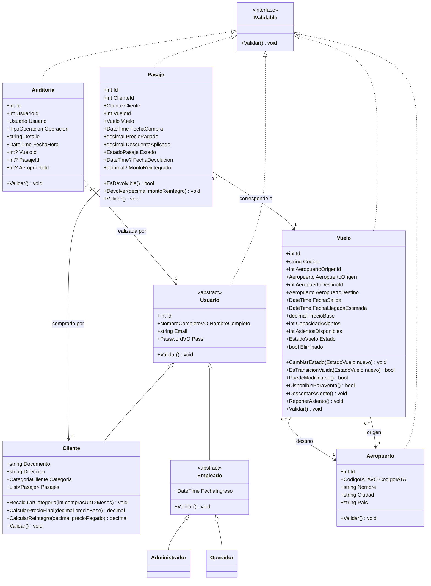
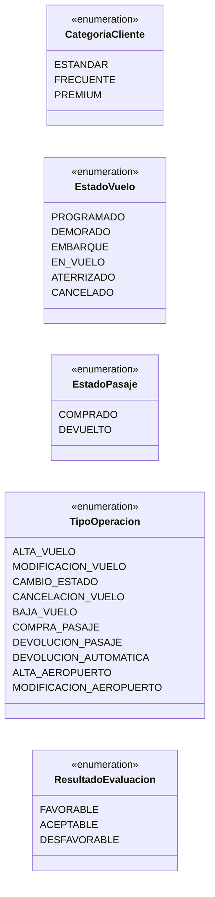
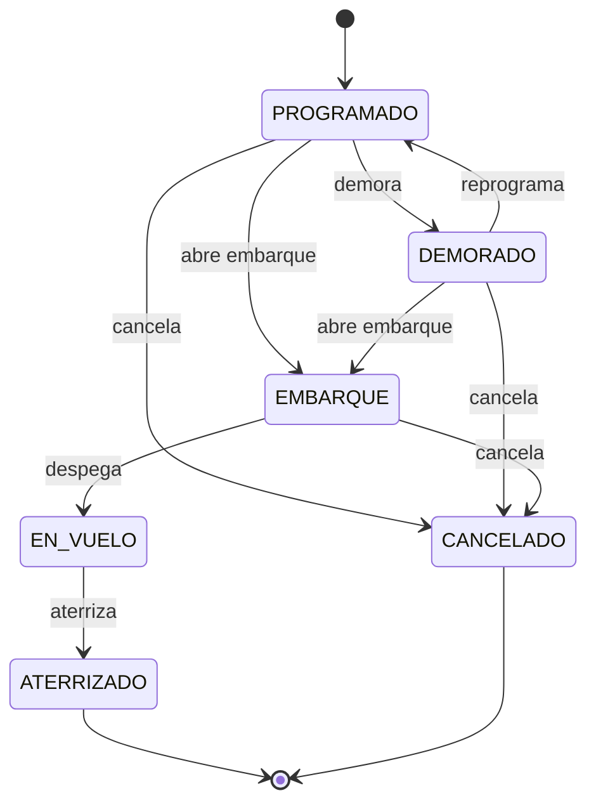
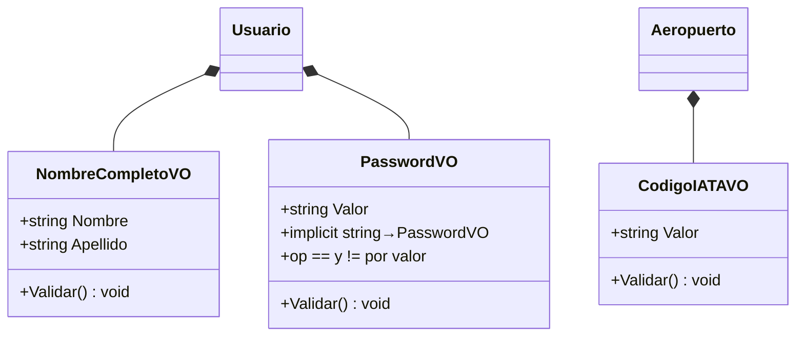
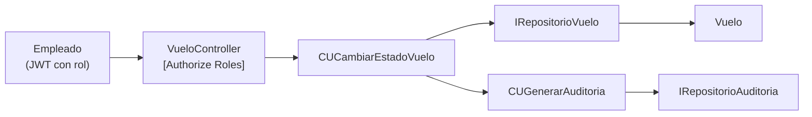

# 📐 AeroGate — Diagrama de Clases del Dominio (LogicaNegocio)

> Modelo de dominio derivado de [LETRA.md](../LETRA.md) — versión 3, **congelada** (categoría como enumerado, `Aeropuerto` sin baja, VOs recortados a tres).
> Convenciones heredadas de StellarMinds: entidades con `props + ctor vacío + ctor completo + Validar()`,
> interfaz `IValidable`, excepciones por entidad, VOs agrupados por carpeta.

Los diagramas están en **Mermaid**: se renderizan solos en GitHub, o en VS Code con la extensión *Markdown Preview Mermaid Support*, o pegándolos en [mermaid.live](https://mermaid.live).

---

## 1. Entidades y herencia (TPH)



**Notas del diagrama:**

- `Usuario` y `Empleado` son **abstractas**. La jerarquía completa se mapea con **TPH** en una sola tabla `Usuarios` con columna discriminadora (`TipoUsuario`: `CLIENTE` / `ADMINISTRADOR` / `OPERADOR`). El rol del JWT se deriva del tipo concreto.
- `Cliente.Categoria` es el **enumerado** `CategoriaCliente`. Las reglas de descuento, reintegro y rangos de compras viven como lógica de `Cliente` (ver sección 2.1) — no hay entidad ni tabla de categorías.
- `Email`, `Documento` y `Direccion` son `string` validados en el `Validar()` de su entidad (formato de email, cédula de 7-8 dígitos, no vacíos) — mismo enfoque que StellarMinds.
- `Vuelo` referencia **dos aeropuertos** (origen y destino). `Vuelo.Validar()` exige que sean distintos; que ambos existan lo controla el caso de uso (necesita repositorio).
- `Vuelo.Codigo` es `string` validado en `Validar()` con formato `AA999` (dos letras + números, ej. `AS101`).
- `Pasaje` guarda `PrecioPagado` y `DescuentoAplicado` como **foto histórica**: si el cliente cambia de categoría después, la compra no se recalcula.
- La devolución vive dentro de `Pasaje` (no es entidad aparte): `Devolver()` fija `Estado = DEVUELTO`, `FechaDevolucion` y `MontoReintegrado`. Quién la hizo y cuándo queda en `Auditoria`.
- `Auditoria` es **inmutable** (solo alta) y conecta con `Usuario` (la base de la jerarquía), por lo que registra operaciones de **cualquier** tipo de usuario: Administrador, Operador o Cliente.

---

## 2. Enumerados



> `ResultadoEvaluacion` es solo para el RF opcional de IA con fallback.

### 2.1 Reglas asociadas a `CategoriaCliente`

Las categorías son un enumerado y sus reglas las **encapsula `Cliente`** (constantes + `switch` sobre `Categoria`):

| Categoría | Compras últimos 12 meses | Descuento | Reintegro |
|-----------|-------------------------:|----------:|----------:|
| `ESTANDAR` | 0 a 4 | 0 % | 70 % |
| `FRECUENTE` | 5 a 9 | 10 % | 90 % |
| `PREMIUM` | 10 o más | 15 % | 100 % |

- `Cliente.RecalcularCategoria(int comprasUlt12Meses)` — asigna el enum según el rango. La cantidad la aporta el caso de uso vía `IRepositorioPasaje.ContarComprasUltimos12Meses()`.
- `Cliente.CalcularPrecioFinal(decimal precioBase)` — aplica el descuento de su categoría actual.
- `Cliente.CalcularReintegro(decimal precioPagado)` — aplica el porcentaje de reintegro de su categoría actual.

> Trade-off asumido: los porcentajes quedan como constantes en el dominio (no configurables por datos). Si en el futuro se quisieran editar sin recompilar, se promueve el enum a entidad — el resto del diseño no cambia.

---

## 3. Máquina de estados del vuelo



- La validación de transiciones vive en `Vuelo.CambiarEstado()` / `Vuelo.EsTransicionValida()`: cualquier transición fuera del diagrama lanza `VueloException`.
- Pasar a `CANCELADO` dispara (en el caso de uso, no en la entidad) la devolución automática del 100 % de todos los pasajes `COMPRADO` + una `Auditoria` de tipo `DEVOLUCION_AUTOMATICA` por cada uno.
- Reglas asociadas a estados:
  - Modificación de datos del vuelo → solo en `PROGRAMADO`.
  - Venta de pasajes → solo en `PROGRAMADO` o `DEMORADO` (con asientos disponibles).
  - Devolución voluntaria → solo mientras el vuelo esté en `PROGRAMADO` o `DEMORADO`.

---

## 4. Value Objects



**Organización en carpetas** (dos grupos, como en StellarMinds):

```
ValueObjects/
├── VOUsuario/     → NombreCompletoVO, PasswordVO
└── VOAeropuerto/  → CodigoIATAVO
```

> `RutaVO` se eliminó: origen y destino ahora son asociaciones a `Aeropuerto` (claves foráneas), no strings. En su lugar nace `CodigoIATAVO`.
> `EmailVO`, `DireccionVO` y `DocumentoVO` se recortaron: esos campos son `string` y se validan en el `Validar()` de su entidad, como en StellarMinds.

**Validaciones de cada VO:**

| VO | Regla |
|----|-------|
| `NombreCompletoVO` | Nombre y apellido no vacíos |
| `PasswordVO` | Largo ≥ 8, al menos una mayúscula, un número y un carácter especial. Comparación por valor (`==`/`!=`) |
| `CodigoIATAVO` | Exactamente 3 letras mayúsculas (ej. `MVD`, `EZE`, `GRU`). Unicidad vía repositorio |

Validaciones que quedaron en las entidades (campos `string`): email con formato válido y único (`Usuario.Validar()` + repositorio), documento de 7-8 dígitos y dirección no vacía (`Cliente.Validar()`).

Todos se mapean con `[ComplexType]` / Owned Types (columnas tipo `NombreCompleto_Nombre`, `CodigoIATA_Valor`, etc.).

---

## 5. Interfaces de repositorios (IRepositorios)

> Revisadas tras el cambio de categoría a enumerado: **desaparece `IRepositorioCategoriaCliente`**
> (no hay tabla de categorías que consultar). El único dato externo que necesita el recálculo
> es la cantidad de compras, y eso ya lo da `IRepositorioPasaje.ContarComprasUltimos12Meses()`.

```csharp
public interface IRepositorioUsuario
{
    void Add(Usuario u);
    void Update(Usuario u);                 // persiste el recálculo de categoría
    Usuario FindById(int id);
    Usuario FindByEmail(string email);      // login + control de unicidad
    List<Usuario> GetAll();                 // gestión de usuarios (Admin)
    List<Cliente> GetClientes();
}

public interface IRepositorioAeropuerto
{
    void Add(Aeropuerto a);
    void Update(Aeropuerto a);              // modificación (no hay baja)
    Aeropuerto FindById(int id);
    Aeropuerto FindByCodigoIATA(string codigo);   // control de unicidad
    List<Aeropuerto> GetAll(string filtro);       // búsqueda por código/ciudad/país + dropdowns
}

public interface IRepositorioVuelo
{
    void Add(Vuelo v);
    void Update(Vuelo v);                   // modificación, cambio de estado y baja lógica
    Vuelo FindById(int id);
    Vuelo FindByCodigo(string codigo);      // control de código único
    List<Vuelo> GetAll();                   // admin: incluye filtros por estado/fecha
    List<Vuelo> GetByAeropuerto(int aeropuertoId);        // filtros por origen/destino
    List<Vuelo> GetDisponiblesParaVenta();  // PROGRAMADO o DEMORADO, con asientos, no eliminados
}

public interface IRepositorioPasaje
{
    void Add(Pasaje p);
    void Update(Pasaje p);                  // devoluciones
    Pasaje FindById(int id);
    List<Pasaje> GetByCliente(int clienteId);
    List<Pasaje> GetByClienteMesAnio(int clienteId, int mes, int anio);  // mis pasajes
    List<Pasaje> GetActivosByVuelo(int vueloId);          // devolución automática al cancelar
    List<Cliente> GetPasajerosPorVuelo(int vueloId);      // pasajeros de un vuelo
    int ContarComprasUltimos12Meses(int clienteId);       // recálculo de categoría (enum)
    List<RankingDestino> GetRankingDestinos();            // ranking de destinos
}

public interface IRepositorioAuditoria
{
    void Add(Auditoria a);                  // solo alta: la auditoría es inmutable
    Auditoria FindById(int id);
    List<Auditoria> GetAll();               // Administrador (con filtros tipo/fechas)
    List<Auditoria> GetByUsuario(int usuarioId);  // Operador: solo las suyas
}
```

---

## 6. Excepciones e interfaces de servicio

```
Excepciones/
├── UsuarioException.cs
├── AeropuertoException.cs
├── VueloException.cs
├── PasajeException.cs
└── AuditoriaException.cs

InterfacesDominio/
└── IValidable.cs

InterfacesServicio/
└── IEvaluacionClimaService.cs   // RF opcional: IA + fallback
```

Cada excepción hereda de `Exception` y se lanza desde `Validar()` o desde los métodos de negocio de su entidad. La API las traduce a HTTP 400/404/409 según el caso. (`CategoriaClienteException` se eliminó junto con la entidad.)

---

## 7. Navegabilidad: cómo opera el Empleado sobre vuelos, pasajes y aeropuertos

Decisión de diseño: **no** se agregan asociaciones `Empleado → Vuelo/Pasaje/Aeropuerto` en el dominio. La "pasarela de datos" del Empleado no es una asociación entre entidades sino la cadena **Controller → Caso de Uso → Repositorio**:



Por qué así:

1. **Las asociaciones entre entidades modelan hechos del negocio, no permisos de acceso.** "Este pasaje es de este cliente para este vuelo" es un hecho persistible. "El operador puede consultar vuelos" es una regla de autorización: vive en `[Authorize(Roles = ...)]` del controller, no en el grafo de objetos.
2. **Una asociación `Empleado → Vuelo` obligaría a una FK sin significado**: ¿qué empleado "posee" un vuelo? ¿el que lo creó, el último que lo modificó, todos? Ninguna respuesta representa el negocio.
3. **En StellarMinds ya funcionaba así**: `Coordinador` no tenía asociación con `Prestamo` en el UML — el acceso era vía casos de uso (las dependencias punteadas `AltaObservacionCU` del diagrama) y la trazabilidad vía `coordinadorId` en `AuditoriaPrestamo`.
4. **La trazabilidad "qué empleado tocó qué" ya está resuelta y mejor**: `Auditoria` asocia `Usuario` (cualquier tipo) con la operación y la entidad afectada (`VueloId` / `PasajeId` / `AeropuertoId`). Ese es el vínculo Empleado↔entidades en el modelo, y es histórico y completo.

> Alternativa descartada pero válida si se quisiera: agregar `CreadoPorId` en `Vuelo` (estilo `coordinadorId` de StellarMinds). Se descartó porque `Auditoria` ya registra el alta con más detalle y sin duplicar el dato.

---

## 8. Resumen de responsabilidades por clase

| Clase | Responsabilidad de negocio clave |
|-------|----------------------------------|
| `Vuelo` | Máquina de estados, control de asientos, reglas de modificación/eliminación |
| `Aeropuerto` | Catálogo estable de orígenes/destinos con código IATA único (no se elimina) |
| `Pasaje` | Foto histórica del precio, ciclo COMPRADO→DEVUELTO |
| `Cliente` | Categoría (enum) + cálculo de descuento, reintegro y recálculo de categoría |
| `Auditoria` | Registro inmutable de quién hizo qué y cuándo, para todo tipo de usuario |
| Casos de uso (capa Aplicación) | Orquestación: comprar (descuenta asiento + recalcula categoría + audita), cancelar vuelo (cambia estado + devoluciones automáticas + audita), etc. |
